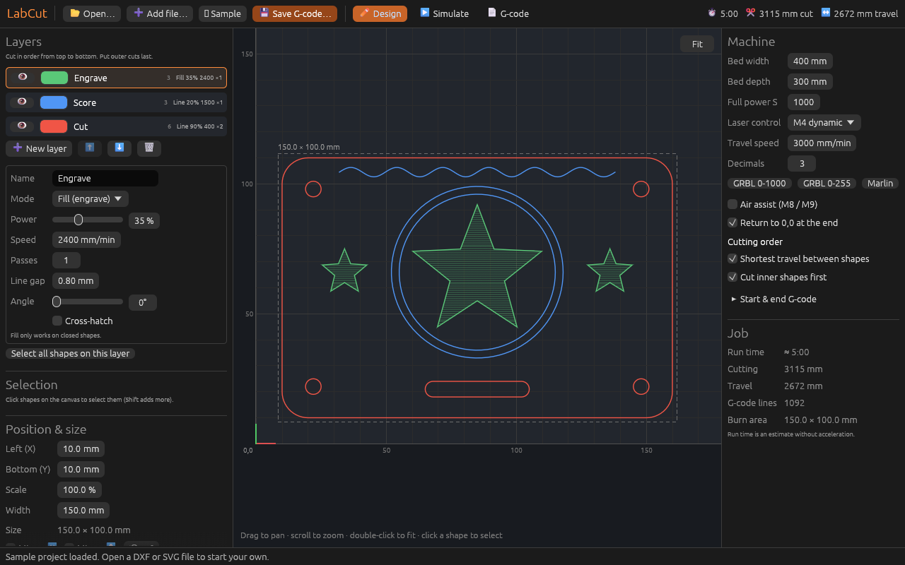
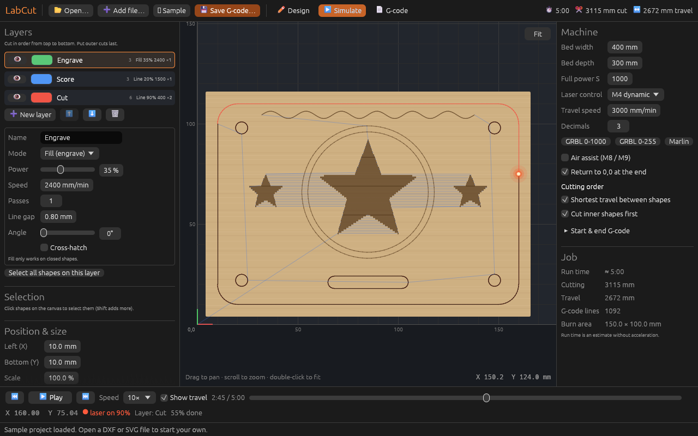

# LabCut

LabCut is a desktop app that turns drawings into G-code for laser cutters and engravers.
Open a **DXF** or **SVG** file, choose power, speed and passes for each layer, check
the job in the preview and the cut simulator, then save a `.gcode` file for your laser.





## What it does

- **Opens DXF and SVG drawings.** It reads lines, arcs, circles, ellipses, polylines,
  splines and blocks from DXF, and paths and basic shapes from SVG.
- **Uses layers.** Each DXF layer or SVG stroke colour becomes its own layer. Each layer
  has its own mode (cut/score outline, fill-engrave or off), power, speed and number of passes.
- **Cuts in a sensible order.** Holes are cut before the outline around them. Shapes are
  ordered to keep travel short.
- **Preview.** Zoom, pan and click shapes on a picture of your laser bed.
- **Cut simulator.** Plays the job back at up to 1000× speed, with burn marks, travel moves,
  the laser head and an estimated run time.
- **Opens existing G-code** (`.gcode`, `.nc`, `.ngc`, `.tap` …) so you can simulate files made elsewhere.
- **Works with common controllers.** GRBL (M4 dynamic power or M3 constant power), with
  presets for Marlin and S 0–255 machines.
- **Command-line conversion.** `labcut drawing.dxf --export drawing.gcode`

## Documentation

| Guide | What's in it |
|---|---|
| [Installation](docs/INSTALL.md) | Building and installing on **Windows**, **macOS** and **Linux** |
| [User guide](docs/USER_GUIDE.md) | How to use every part of the app, from opening a file to running the laser |

## Quick start (any system)

1. Install Rust from <https://rustup.rs> (version 1.95 or newer).
2. In this folder, run:
   ```
   cargo build --release
   ```
3. Start the app:
   - Windows: `target\release\labcut.exe`
   - macOS / Linux: `./target/release/labcut`

See [Installation](docs/INSTALL.md) for the extra system packages you may need, and for
adding LabCut to your Start menu, Applications folder or app launcher.

## Safety

Laser cutters can start fires and damage eyes. Never leave a running laser alone, use
the right eye protection, and test new power and speed settings on scrap material first.
LabCut's run time is only an estimate, and its simulator doesn't know about your
machine's limits.
