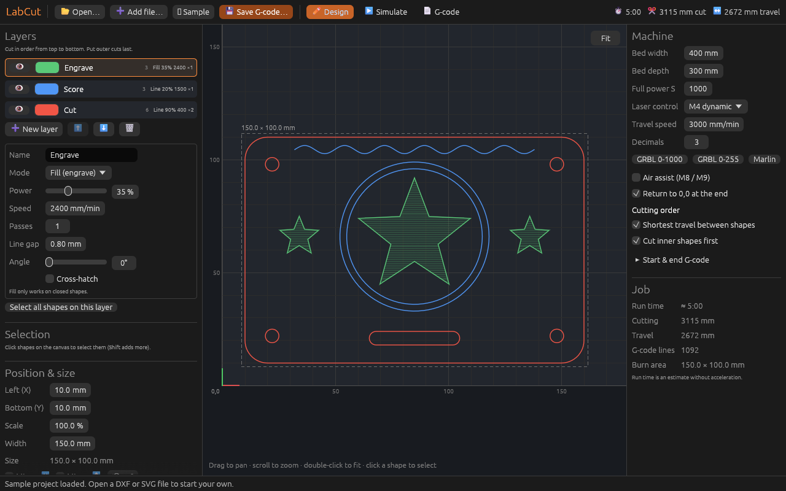
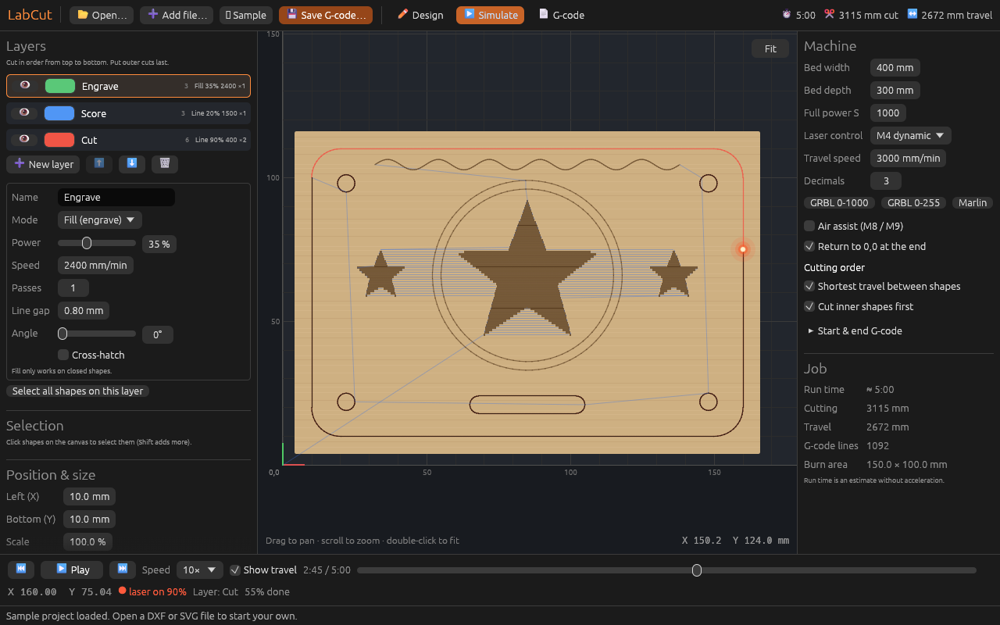
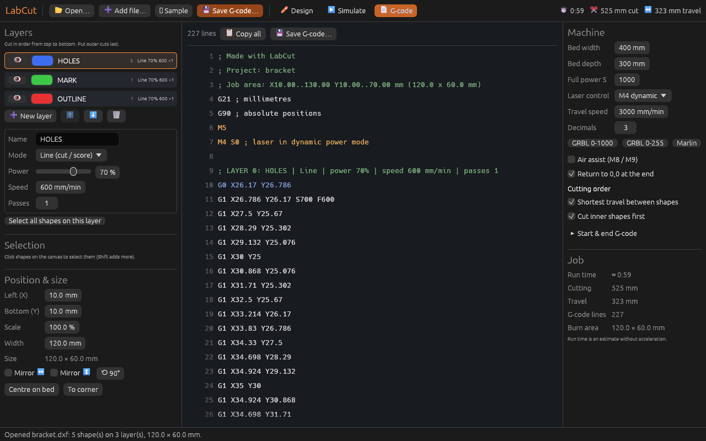

# LabCut user guide

This guide covers every part of LabCut: opening drawings, setting up layers, placing the job
on the bed, checking it in the simulator and saving the G-code for your laser.

- [The window](#the-window)
- [1. Open a drawing](#1-open-a-drawing)
- [2. Set up the layers](#2-set-up-the-layers)
- [3. Select and move shapes between layers](#3-select-and-move-shapes-between-layers)
- [4. Position and size](#4-position-and-size)
- [5. Machine settings](#5-machine-settings)
- [6. Check the job in the simulator](#6-check-the-job-in-the-simulator)
- [7. Save the G-code and run it](#7-save-the-g-code-and-run-it)
- [Opening G-code made elsewhere](#opening-g-code-made-elsewhere)
- [Preparing drawings](#preparing-drawings)
- [Keyboard and mouse](#keyboard-and-mouse)
- [Command line](#command-line)
- [What the G-code looks like](#what-the-g-code-looks-like)
- [Questions](#questions)

---

## The window



| Area | What it's for |
|---|---|
| **Top bar** | **📂 Open…**, **➕ Add file…**, **★ Sample**, **💾 Save G-code…**, and the three views: **✏ Design**, **▶ Simulate** and **📄 G-code**. The right end shows the estimated run time, the cutting length and the travel length. |
| **Left panel** | **Layers** and their settings, the **Selection**, and **Position & size**. |
| **Middle** | The canvas: your laser bed with a 10 mm grid. The red and green arrows mark the origin (0,0), bottom left. |
| **Right panel** | **Machine** settings and the **Job** summary. |
| **Bottom line** | Messages, for example what was loaded or why something didn't work. |

The panels can be made wider or narrower by dragging their edges.

LabCut starts with a **sample project** (a tag with an engraved star, scored rings and a
cut outline) so you can try everything straight away. **★ Sample** brings it back at any time.

---

## 1. Open a drawing

Click **📂 Open…** (or press **Ctrl+O**, **⌘O** on a Mac) and choose a file. You can also
drag a file from your file manager onto the window.

| File type | Extensions | Notes |
|---|---|---|
| DXF drawing | `.dxf` | Text (ASCII) DXF from any CAD program. Each DXF layer becomes a LabCut layer. |
| SVG drawing | `.svg` | From Inkscape, Illustrator, Affinity, Figma and others. Each stroke colour becomes a layer. |
| G-code | `.gcode` `.nc` `.gc` `.ngc` `.tap` `.cnc` `.g` | Opened for preview and simulation only. See [Opening G-code made elsewhere](#opening-g-code-made-elsewhere). |

After opening, the bottom line tells you how many shapes and layers were found and how big
the drawing is, and lists anything that was skipped (for example `TEXT` or `HATCH`).

**➕ Add file…** adds another drawing to the current project instead of replacing it. The new
drawing is placed 10 mm to the right of what's already there. Layers with the same name are
shared, so two DXF files that both use a `CUT` layer get the same cut settings.

LabCut joins loose lines whose ends touch (within 0.01 mm) into one continuous shape.
A rectangle drawn as four separate lines is therefore cut as one closed outline.

---

## 2. Set up the layers

Layers are how you tell the laser what to do with each part of the drawing.

### The layer list

Each row in **Layers** shows:

- **👁**: show or hide the layer on the canvas. Hiding a layer doesn't stop it being cut. Set its mode to **Off** for that.
- **The colour swatch**: click it to change the colour used on screen.
- **The name**: click it to select the layer and edit its settings below.
- **On the right**: the number of shapes on the layer, then its mode, power, speed and passes (for example `Line 90% 400 ×2`).

**Layers are cut in order from top to bottom.** Use **⬆** and **⬇** to change the order.
Usually you engrave first, score next and cut outlines last, so the part is still held in
the sheet while the details are burned. When you open a file, LabCut puts the layer with
the biggest shape (normally the outline) at the bottom for you.

**➕ New layer** adds an empty layer. **🗑** removes the selected layer and moves its shapes to another layer.

### Layer settings

| Setting | What it does |
|---|---|
| **Name** | The layer's name. It's also written into the G-code as a comment. |
| **Mode** | **Line (cut / score)**: the laser follows the outline of each shape. Use it for cutting through and for light scoring lines. <br>**Fill (engrave)**: the inside of each closed shape is burned with back-and-forth lines. <br>**Off**: the layer is shown faintly but not burned. |
| **Power** | Laser power, 0–100 % of your machine's full power. |
| **Speed** | How fast the head moves while burning, in mm per minute. Slower burns deeper. |
| **Passes** | How many times the whole layer is repeated. Several fast passes often cut cleaner than one slow pass. |
| **Line gap** *(Fill only)* | The distance between fill lines. Smaller is darker and smoother but takes longer. 0.1–0.2 mm is typical. |
| **Angle** *(Fill only)* | The direction of the fill lines, 0° (left–right) to 180°. |
| **Cross-hatch** *(Fill only)* | Fill a second time at 90° to the first for an even, darker result. |

Fill works on **closed** shapes only. Shapes inside shapes alternate: a ring (a circle with
a smaller circle inside) is filled only between the two circles, like a donut.

Every change shows up straight away in the preview, the run time and the G-code.

---

## 3. Select and move shapes between layers

- **Click** a shape on the canvas to select it. It turns white.
- **Shift+click** (or Ctrl+click) adds or removes shapes from the selection.
- Click on empty space, or press **Esc**, to clear the selection.
- **Select all shapes on this layer** (under the layer settings) selects every shape on the chosen layer.

When shapes are selected, the **Selection** box offers:

- **Move to**: put the selected shapes on another layer, or on **➕ a new layer**. This is
  how you split one drawing into several cut settings, for example to engrave a logo that
  was drawn on the same layer as the outline.
- **🗑 Delete** (or the **Delete** key): remove the shapes from the project. This doesn't change your drawing file.
- **Clear**: deselect.

---

## 4. Position and size

**Position & size** controls where the job sits on the laser bed.

| Setting | What it does |
|---|---|
| **Left (X)**, **Bottom (Y)** | Where the bottom-left corner of the job goes, in mm from the machine origin. |
| **Scale** | Size in percent of the original drawing. |
| **Width** | Type the width you want in mm. The height follows, keeping the proportions. |
| **Size** | The finished width × height. |
| **Mirror ↔ / Mirror ↕** | Flip the job left–right or top–bottom. |
| **⟲ 90°** | Turn the job a quarter turn anticlockwise. |
| **Centre on bed** | Put the job in the middle of the bed. |
| **To corner** | Put the job at 0,0. |

The canvas shows the job's outer box as a dashed rectangle with its size.
If any part of the job is outside the bed, the **Job** panel shows **⚠ Part of the job is outside the bed.**

Drawing units: DXF files are read in the units saved in the file (mm, cm, m or inches). If
the file doesn't say, millimetres are assumed. SVG files use their width and height (for
example `width="100mm"`). If those are missing, 96 pixels per inch is assumed, the same as Inkscape.

---

## 5. Machine settings

Set these once for your laser. The defaults suit most GRBL-based diode lasers.

| Setting | Default | What it does |
|---|---|---|
| **Bed width / Bed depth** | 400 × 300 mm | The size of your working area. It's drawn as the dark rectangle on the canvas. |
| **Full power S** | 1000 | The `S` value your controller treats as 100 % power. GRBL is usually 1000 (`$30`). Marlin and some GRBL boards use 255. |
| **Laser control** | M4 dynamic | **M4 dynamic (GRBL laser mode)**: power is lowered automatically when the head slows down in corners, which gives cleaner corners. The laser turns off by itself during `G0` travel moves. **Your GRBL machine must have laser mode on (`$32=1`).** <br>**M3 constant**: `M3` turns the laser on before each shape and `M5` turns it off before each travel move. This works on almost any controller. |
| **Travel speed** | 3000 mm/min | Used to estimate run time for travel moves. Travel moves are written as `G0` (full speed), so your machine decides the real speed. |
| **Decimals** | 3 | Digits after the decimal point in coordinates. |
| **GRBL 0-1000 / GRBL 0-255 / Marlin** | | Quick presets for **Full power S** and **Laser control**. |
| **Air assist (M8 / M9)** | off | Turns air assist (or coolant output) on at the start and off at the end. |
| **Return to 0,0 at the end** | on | Moves the head back to the origin when finished. |
| **Shortest travel between shapes** | on | Orders shapes to keep travel short, and starts each closed shape at the point nearest the head. Turn it off to cut shapes in drawing order. |
| **Cut inner shapes first** | on | Holes and details inside a shape are cut before that shape's outline, so parts don't fall out or move before they're finished. (This works within each layer. Across layers, use the layer order.) |
| **Start & end G-code** | empty | Your own lines to add at the start (after `G21`/`G90`) and at the end (before `M2`). For example `$H` to home first, or `G0 Z10`. |

> **Safety:** with **M4 dynamic**, if your GRBL machine has `$32=0` (laser mode off), the
> laser can stay on during travel moves. Check `$32=1` in your controller settings, or use **M3 constant**.

### The Job panel

**Run time**, **Cutting** length, **Travel** length, number of **G-code lines** and the
**Burn area** (the box the laser actually burns in). The run time is an estimate: it
divides each distance by its speed and doesn't include acceleration, so real jobs with many small
details take somewhat longer.

---

## 6. Check the job in the simulator

Click **▶ Simulate** in the top bar.



The job is drawn on a wood-coloured sheet. Burned lines appear in dark brown (stronger
power is darker). Fill engraving is drawn as solid areas. Parts not yet burned are shown
faintly in their layer colour, and blue lines show the travel moves already made.
The **laser head** glows red and orange while firing, and is a blue cross-hair while moving with the laser off.

| Control | What it does |
|---|---|
| **⏮** | Back to the start. |
| **▶ Play / ⏸ Pause** | Start or stop (or press **Space**). |
| **⏭** | Jump to the end and see the finished job. |
| **Speed** | Playback speed: 1× is real time, up to 1000×. |
| **Show travel** | Show or hide the blue travel lines. |
| **Time / slider** | Elapsed and total time. Drag the slider to any moment of the job. |
| **Bottom line** | The head position (X, Y), whether the laser is on and at what power, the current layer and how much is done. |

Things to look for:

- inner holes and details are cut **before** the outline around them;
- fills cover what you expect, and nothing extra;
- nothing is burned that should be **Off**;
- the job fits on your material.

---

## 7. Save the G-code and run it

1. Click **💾 Save G-code…** (or press **Ctrl+S**, **⌘S** on a Mac), choose a name and save.
   The file name is taken from the drawing's name.
2. To look at the code first, open **📄 G-code**.

   

    It's colour-coded: comments are green,
   travel moves blue and laser commands orange. **📋 Copy all** copies the whole program, so you can paste it into a sender.
3. Send the file to your laser with the program you normally use, for example
   LaserGRBL, Universal Gcode Sender, CNCjs, bCNC, OctoPrint or your machine's SD card.

Before running:

- **Set the origin.** LabCut's 0,0 is the machine's 0,0 (bottom left). Home the machine or set your work origin to where 0,0 should be.
- **Focus the laser** for your material's thickness.
- **Frame the job.** Most senders can trace the outer box. LabCut prints the job area at the top of the file, for example `; Job area: X10.00..160.00 Y10.00..110.00 mm`.
- **Test** new materials with a small square first and adjust power, speed and passes.
- **Never leave the laser running alone.** Keep a fire extinguisher nearby and wear safety glasses made for your laser's wavelength.

---

## Opening G-code made elsewhere

Open a `.gcode`, `.nc`, `.ngc` (or similar) file with **📂 Open…** to preview and simulate it.
This works for files made by other programs too. LabCut understands:

- `G0`, `G1`, and the arcs `G2` / `G3` (with `I`/`J` or `R`)
- `G20` / `G21` (inches / mm) and `G90` / `G91` (absolute / relative)
- `M3`, `M4` (laser on), `M5` (laser off), `S` (power) and `F` (speed)

The left panel shows **G-code file**: this file can be simulated but not edited.
**Back to my design** returns to your project. Power percentages in the simulator are worked out
from **Full power S** in the machine settings.

---

## Preparing drawings

**From CAD programs (DXF)**

- Save as **ASCII/text DXF** (binary DXF isn't supported). Any DXF version (R12 to 2018) is fine.
- Supported: `LINE`, `ARC`, `CIRCLE`, `ELLIPSE`, `LWPOLYLINE` and 2D `POLYLINE` (including curved segments), `SPLINE`, and `INSERT` blocks (including scaled, rotated and arrayed blocks).
- Not cut: `TEXT`/`MTEXT` (explode text into lines or polylines first), `HATCH`, dimensions, images, 3D objects.
- Put parts that need different settings on **different layers**, for example `CUT`, `SCORE` and `ENGRAVE`.

**From drawing programs (SVG)**

- Convert **text to paths** (Inkscape: *Path → Object to Path*). Images and text aren't cut.
- Give each kind of operation its own **stroke colour**, for example red for cuts, blue for scoring and black for engraving. Each colour becomes a LabCut layer named after it (like `#FF0000`). Shapes without a stroke use their fill colour.
- Hidden objects (`display:none`) are skipped. Clones (`<use>`) aren't supported, so unlink them first (Inkscape: *Edit → Clone → Unlink Clone*).
- Set the document size in millimetres so the sizes come out exactly right.

---

## Keyboard and mouse

| Action | How |
|---|---|
| Open a file | **Ctrl+O** (⌘O), or drag a file onto the window |
| Save G-code | **Ctrl+S** (⌘S) |
| Pan the view | Drag on the canvas |
| Zoom | Mouse wheel or touchpad scroll (zooms around the pointer), or pinch |
| Fit the job in view | **Double-click** the canvas, or the **Fit** button (top right of the canvas) |
| Select a shape | Click it (Design view) |
| Add to or remove from the selection | **Shift+click** or **Ctrl+click** |
| Clear the selection | **Esc** or click empty space |
| Delete selected shapes | **Delete** |
| Play / pause the simulator | **Space** (Simulate view) |

The pointer's position on the bed (in mm) is shown at the bottom right of the canvas.

---

## Command line

```
labcut                          open the app with the sample project
labcut FILE                     open a DXF, SVG or G-code file
labcut FILE --export OUT.gcode  convert a drawing to G-code without opening the window
labcut --help                   show this help

--tab design|sim|code           start on this tab
--progress 0.5                  start the simulator part-way (0 to 1)
--screenshot FILE.png           draw 120 frames, save a picture of the window and exit
```

`--export` uses the default settings: GRBL, M4 dynamic, Full power S 1000, every layer
as **Line** at 70 % power and 600 mm/min, one pass, placed at X 10, Y 10. It's handy for
quick conversions and scripts. Use the app for anything that needs other settings.

---

## What the G-code looks like

A short example made with the default settings:

```gcode
; Made with LabCut
; Project: bracket
; Job area: X10.00..130.00 Y10.00..70.00 mm (120.0 x 60.0 mm)
G21 ; millimetres
G90 ; absolute positions
M5
M4 S0 ; laser in dynamic power mode

; LAYER 0: HOLES | Line | power 70% | speed 600 mm/min | passes 1
G0 X26.17 Y26.786
G1 X26.786 Y26.17 S700 F600
G1 X27.5 Y25.67
G1 X28.29 Y25.302
...
G1 X110 Y70

M5 ; laser off
G0 X0 Y0
M2 ; end of program
```

- Positions are absolute, in millimetres.
- Power is `S` = layer power × **Full power S** (70 % of 1000 = `S700`).
- `F` (speed) and `S` are written only when they change, to keep the file small.
- Each layer starts with a `; LAYER n: …` comment showing its settings.

---

## Questions

**My laser doesn't fire, or fires during travel moves.**
Check **Full power S** and **Laser control** in the machine settings (see [Machine settings](#5-machine-settings)).
For GRBL with M4 dynamic, `$32` must be `1`. Otherwise choose **M3 constant**.

**The job is mirrored on my machine.**
Some machines have their origin at the top left or top right. Use **Mirror ↕** or **Mirror ↔**, or change the machine's origin setting.

**The size is wrong after opening an SVG.**
The file probably has no size in mm. Set the document size in your drawing program, or type the right **Width** in **Position & size**.

**Some shapes are missing.**
Read the bottom line after opening: it lists skipped item types (for example `TEXT`, `HATCH`, `IMAGE`).
Convert them to lines or paths in your drawing program.

**Are my settings saved?**
No. Machine and layer settings are reset when you close LabCut. Note your favourite power and speed values,
or keep a G-code file. Each layer's settings are written in its `; LAYER` comment.
